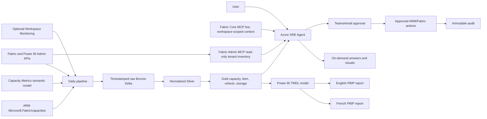
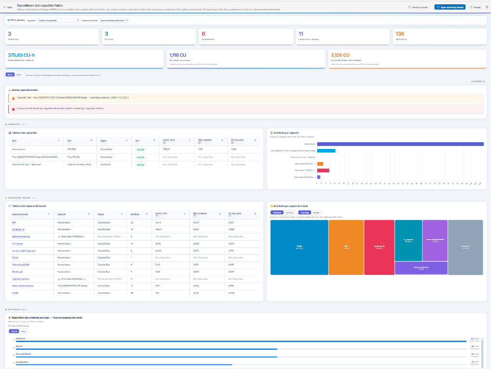

# Fabric SRE solution — architecture and operations

Start by creating Azure SRE Agent, connecting Fabric Core, and exploring visible
resources with the [prompt catalog](prompts.en.md). Then install Basic or
Advanced by following the [deployment guide](deployment.en.md). The architecture
below describes the complete Advanced edition; Basic adds tenant inventory and
the Live Report without deploying the historical workspace.
This first level without Fabric SRE infrastructure is called **Discovery**.

## 1. Assumptions and decisions

1. Advanced uses a Fabric F or P capacity to host a dedicated administration
   workspace; Basic does not require one.
2. The `FabricSRE` Lakehouse is authoritative history, with 400 days by default
   and a validated minimum of 60 days.
3. Collection runs daily; critical conditions can be evaluated every 15 minutes
   after data lands.
4. The Capacity Metrics adapter is validated against the installed app model.
   Microsoft does not publish a stable REST schema contract for that model.
5. The existing agent remains read-only; four allowed actions require an
   approval cryptographically bound to the exact plan.
6. The shared Git core contains no customer identifier.

The reference deployment targets an Azure SRE Agent resource of type
`Microsoft.App/agents`. This service is distinct from Microsoft Foundry hosted
agents and uses its own ARM and data-plane APIs.

## 2. Target architecture

The initial journey stops at `A --> V`. Basic adds Fabric Admin MCP and the Live
Report. Advanced adds the pipeline, Lakehouse, historical tables, semantic
model, and Power BI reports.

The functional release to publish, its responsive acceptance procedure, and
its behavior during a capacity outage are defined in the
[Live Report specification](live-report.en.md). For Advanced, a small Fabric
capacity dedicated to the SRE administration workspace reduces the risk that a
production capacity disables its own monitoring chain.

*French view of the bilingual Live Report, showing global filters, CU
indicators, operational alerts, and capacity, workspace, and item inventory.*

**Why Lakehouse for MVP**: the primary workload is daily collection, Delta,
star-schema analytics, and PBIP/TMDL. Workspace Monitoring plus Eventhouse is a
V2 option for near-real-time signals; it has no backfill.

## 3. Capacity inventory fields, sources, and permissions

| Field | Primary source | Permission/control | Status and notes |
|---|---|---|---|
| Name, ID, SKU | Power BI Admin `GET /admin/capacities` | Fabric admin or principal enabled for read-only admin APIs | GA; 200 requests/hour |
| F/P/Trial type | Admin SKU metadata; ARM enrichment for F | Same plus Azure Reader for F | GA; P/Trial are not ARM Fabric resources |
| Region | Power BI Admin; ARM `location` for F | Tenant.Read.All or Azure Reader | GA |
| Active/paused state | ARM `Microsoft.Fabric/capacities` for F | `capacities/read` | GA 2023-11-01; verify after actions |
| Administrators | ARM `properties.administration.members` for F; admin metadata otherwise | Azure Reader and tenant admin | ARM 2023-11-01 GA |
| Subscription/resource group | ARM resource ID | Azure Reader | GA; not applicable to P/Trial |
| Tags | ARM | Azure Reader | GA |
| Assigned workspaces | Fabric Admin Workspaces grouped by `capacityId` | Read-only admin API | List workspaces GA, 200/hour |
| CU avg/P95/max, 24h/7d/30d | Historical `silver_item_cu` from adapter/Workspace Monitoring | Build/Read on source model or Eventhouse | No confirmed item-level CU REST API |
| Throttling episodes | Capacity Metrics plus Microsoft thresholds | Access to Capacity Metrics model | App GA; Compute retains 14 days |
| Estimated cost | CU/SKU × configured price; optional Azure Retail Prices | Client pricing in parameters | Estimate, not an Azure invoice |

References: [Capacity Metrics](https://learn.microsoft.com/en-us/fabric/enterprise/metrics-app),
[14-day Compute window](https://learn.microsoft.com/en-us/fabric/enterprise/metrics-app-compute-page),
[Get capacities as admin](https://learn.microsoft.com/en-us/rest/api/power-bi/admin/get-capacities-as-admin),
[Admin workspaces](https://learn.microsoft.com/en-us/rest/api/fabric/admin/workspaces/list-workspaces),
[ARM capacities](https://learn.microsoft.com/en-us/azure/templates/microsoft.fabric/capacities),
[pause/resume](https://learn.microsoft.com/en-us/fabric/enterprise/pause-resume).

## 4. Data and retention

Bronze stores raw timestamped API payloads. Inventory snapshots are appended;
Activity Events uses an `Id`-based upsert so repeated 27-day backfills remain
idempotent. Silver stores daily capacity snapshots, item-operation-user CU,
refreshes, storage, and collection runs. Silver and Gold outputs are
materialized as Delta tables—not Spark views—so the Lakehouse SQL endpoint can
publish them to Power BI. History is retained for at least 60 days (400 by
default).

## 5. Power BI reports

The shared TMDL model contains Date, Capacity, Workspace, Item, Operation, and
four daily facts. French and English reports are separate PBIP files.

After publishing, replace the model's default SQL connection with an explicit
cloud connection under **Semantic model settings > Gateway and cloud
connections**. The reference deployment provisions a Fabric workspace
identity, grants it the workspace Viewer role, and uses a
`WorkspaceIdentity` SQL connection; no user secret is stored. Service refresh
is rejected until this binding exists, even when the user administers the
Lakehouse.

1. **Capacity health**: KPIs, CU by capacity, trend, risk queue.
2. **Top 15 CU**: 7/30/60-day period with capacity, workspace, item type, and
   operation filters.
3. **Item detail**: ItemId drillthrough with metadata, 60-day trend, duration,
   failures, users, and contribution.
4. **Operations and governance**: refresh latency/failures, endorsement, and
   prioritized exceptions.

All four pages use a 16:9 canvas that defaults to fit-to-width in the browser.
The generator sizes the KPI, chart, and detail bands from each page's KPI count
and detail-measure count: low-density matrices stay compact and the released
space is assigned to the charts. Margins, gutters, and filter zones remain
fixed to prevent overlap and truncated text.
Horizontal bar charts limit inter-category spacing to 18% and de-emphasize
gridlines, so bars remain visually grouped even when only a few capacities or
workspaces are present.

## 6. Prioritized additional metrics

| Priority | Admin question | Source | Suggested threshold |
|---|---|---|---|
| MVP | Which running capacity is underused? | Gold CU + ARM state/SKU | average <20% for 7d and no peak >50% |
| MVP | Which refreshes fail or run slowly? | Activity Events/refresh history | success <98% or P95 >30 min |
| MVP | Which content is inactive or orphaned? | Admin inventory + activity | item 60d, workspace 90d, no valid admin |
| MVP | Where does throttling affect users? | Historical Capacity Metrics | any rejection or >180 min above 80% |
| MVP | What lacks certification or a domain? | scanner/admin/domain APIs | production content noncompliant after 14d |
| V2 | How fast is OneLake storage growing? | Storage app/inventory | +20% over 30d |
| V2 | How much Copilot/AI is consumed? | Capacity Metrics when exposed | +30% WoW or budget exceeded |
| V2 | Did tenant settings drift? | Tenant Settings API | any approved-baseline difference |
| V2 | Are gateways healthy? | Power BI Gateways API | unavailable >15 min |
| V2 | What is anomalous in near real time? | Workspace Monitoring/Eventhouse | z-score >3 and client impact threshold |

## 7. Permissions

Enable **Service principals can use Fabric APIs** and separately enable
**read-only admin APIs** for the managed identity security group. Enable update
admin APIs only for a separate action identity. Grant Azure Reader for
collection and a narrow custom role containing capacity read/write/suspend/
resume actions for approved changes. Do not grant Contributor to the read
identity.

Place the dedicated `FabricAdmin` service principal in the security group
allowed to call read-only admin APIs. Tenant inventory does not require a
Viewer assignment on every workspace.

See [admin API service principal setup](https://learn.microsoft.com/en-us/fabric/admin/enable-service-principal-admin-apis)
and [identity support](https://learn.microsoft.com/en-us/rest/api/fabric/articles/identity-support).

## 8. Agent and alerts

`agent/subagents.yaml` defines Inventory, Capacity and cost, Governance, and
Incidents. `agent/routines.yaml` defines the daily digest, sustained-high
capacity alert, freshness guard, and weekly optimization review. Alerts never
perform an automatic resize, pause, resume, or reassignment.

Where agent extensions and handoffs are enabled, the four roles can be
deployed as separate subagents. In the reference tenant, the API rejects new
handoffs in workspace mode and the ARM API reports that extensions are limited
to internal tenants. `agent/azure-sre-agent.yaml` therefore implements the
supported compatibility mode: one router carrying the four logical roles and
the read-only Fabric MCP tools. The separate definitions remain versioned for
future activation without a redesign.

The `FabricAdmin` connector exposes `FabricAdmin_list_workspaces`,
`FabricAdmin_list_items`, and `FabricAdmin_get_cu_metrics` through an
API-key-protected Streamable HTTP MCP service. The first two tools use
`/v1/admin/workspaces` and `/v1/admin/items`, exclude personal and inactive
workspaces by default, prewarm their cache, and serve stale data while
refreshing so Live Report calls remain within their timeout.
`FabricAdmin_get_cu_metrics` queries the Fabric Capacity Metrics semantic model
for 7, 14, 30, or 60 days. It returns CU-second totals, sustained average CU,
peak daily average CU, and an optional daily series for a selected item,
workspace, or capacity.
The report distinguishes a present zero value from unavailable telemetry and
displays the period actually covered. Reproduce the deployment with
`scripts/deploy-fabric-admin-mcp.ps1 -ConfigurationPath config/client.parameters.yaml`.
Fabric Core remains available for detailed operations scoped to workspaces the
agent identity can access.

## 9. Known limits and status

- Capacity Metrics Compute: 14 days; Storage: 30 days.
- A 30- or 60-day CU request against the direct Capacity Metrics source returns
  only the retained period. Daily Lakehouse history remains required to
  guarantee 60 days.
- Activity Events: the rolling 28-day window includes the current UTC day, so automated
  backfill is capped at 27 complete days; start/end must be in one UTC day.
- Admin Items `GET /v1/admin/items` is preview; Admin Workspaces and several
  user-facing operations can also evolve.
- Scanner results remain available for 24 hours; 500 requests/hour and 16
  concurrent requests.
- Admin capacity/workspace/item APIs commonly allow 200 requests/hour.
- Tenant Settings: 25 requests/minute.
- Honor HTTP 429 `Retry-After`; the supplied client does.
- The MCP cache refreshes at most every five minutes, preserves the actual
  collection timestamp, and uses one minimum Container Apps replica to avoid a
  cold Live Report load.
- The `/health` endpoint exposes the cache maintainer status plus each
  inventory's collection timestamp and row count, without exposing secrets.
- NotebookUtils obtains Power BI/Fabric tokens through the `pbi` audience key,
  but it does not provide a general ARM token. Run ARM collection from the
  Azure SRE Agent, a function, or an automation identity; the notebook reports
  this limitation explicitly instead of silently omitting it.
- No general complete-lineage, general certification, or item-size OneLake API.
- Data Activator is GA but cannot directly alert from Capacity Metrics.
- Git Integration and Deployment Pipelines have mixed status by item type.

References:
[Activity Events](https://learn.microsoft.com/en-us/rest/api/power-bi/admin/get-activity-events),
[scanner](https://learn.microsoft.com/en-us/fabric/governance/metadata-scanning-overview),
[Tenant Settings](https://learn.microsoft.com/en-us/rest/api/fabric/admin/tenants/list-tenant-settings),
[Catalog Search](https://learn.microsoft.com/en-us/rest/api/fabric/core/catalog/search),
[Fabric throttling](https://learn.microsoft.com/en-us/fabric/enterprise/throttling),
[Activator](https://learn.microsoft.com/en-us/fabric/real-time-intelligence/data-activator/activator-introduction),
[PBIP](https://learn.microsoft.com/en-us/power-bi/developer/projects/projects-overview),
[TMDL](https://learn.microsoft.com/en-us/analysis-services/tmdl/tmdl-overview).

## 10. Core and client layering

Tag shared releases as `core-vX.Y.Z`. Keep each client overlay in a client
branch/repository containing only its parameter file, additional rules/pages,
and external secret references. Merge a new core tag into a branch, validate,
deploy to dev, compare, then promote. Generators only own generated artifacts;
client pages live in a separate manifest.

## 11. Acceptance criteria

Daily collection succeeds ≥99%, history is ≥60 days, freshness is <30 hours,
inventory reconciles with the portal, Top 15 and drillthrough are exact,
P95/max are tested, agent answers cite freshness and evidence, no action works
without an exact unexpired approval, both PBIR reports validate, TMDL imports,
tests/lint pass, and deployment is idempotent.
