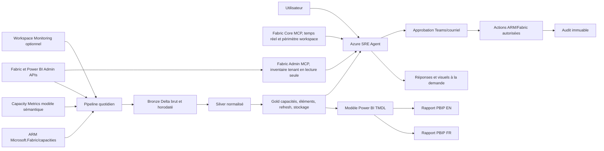

# Solution Fabric SRE — architecture et exploitation

Pour commencer, créer Azure SRE Agent, connecter Fabric Core et explorer les
ressources visibles avec le [catalogue de prompts](prompts.fr.md). Installer
ensuite Basic ou Advanced dans le [guide de déploiement](deployment.fr.md).
L'architecture ci-dessous décrit l'édition Advanced complète; Basic ajoute
l'inventaire tenant et le Live Report sans déployer le workspace historique.
Ce premier niveau sans infrastructure Fabric SRE est appelé **Découverte**.

## 1. Hypothèses et décisions

1. L'édition Advanced utilise une capacité Fabric F ou P pour héberger un
   espace de travail d’administration; l'édition Basic n'en exige pas.
2. Le Lakehouse `FabricSRE` est le magasin historique, avec 400 jours par
   défaut et un minimum validé de 60 jours.
3. La collecte est quotidienne; les signaux critiques peuvent être évalués
   toutes les 15 minutes après l’atterrissage des données.
4. L’adaptateur Capacity Metrics est validé contre la version installée du
   modèle de l’application. Microsoft ne publie pas de contrat de schéma REST.
5. L’agent existant reste en lecture seule; les quatre actions autorisées
   passent par le protocole d’approbation cryptographiquement lié au plan.
6. Aucun identifiant client ne se trouve dans le socle Git.

Le déploiement de référence cible un agent Azure SRE `Microsoft.App/agents`.
Ce service est distinct des agents hébergés Microsoft Foundry et utilise ses
API ARM et data plane propres.

## 2. Architecture cible

Le premier parcours s'arrête à `A --> V`. Basic ajoute Fabric Admin MCP et le
Live Report. Advanced ajoute le pipeline, le Lakehouse, les tables historiques,
le modèle sémantique et les rapports Power BI.

La version fonctionnelle à publier, sa recette responsive et son comportement
en cas d'arrêt de capacité sont définis dans la
[spécification du Live Report](live-report.fr.md). Pour Advanced, une petite
capacité Fabric dédiée au workspace d'administration SRE réduit le risque
qu'une capacité de production interrompe sa propre chaîne de supervision.

Le Live Report repose sur la liaison injectée par la visionneuse Azure SRE à
chaque ouverture. L'actif publié ne doit pas conserver une copie figée de cette
liaison : il utilise `{REPORT_NONCE}` et accepte notamment les listes de blocs
renvoyées sans enveloppe `content`.

*Vue d'ensemble du Live Report bilingue : filtres globaux, indicateurs CU,
alertes opérationnelles et inventaires des capacités, espaces de travail et
artefacts.*

**Pourquoi Lakehouse plutôt qu’Eventhouse au MVP** : le besoin principal est
une collecte quotidienne, un modèle en étoile Direct Lake/Import et Git/PBIP.
Le Lakehouse simplifie Delta, SQL endpoint et Power BI. Workspace Monitoring
peut alimenter un Eventhouse en V2 pour les scénarios quasi temps réel; il
n’offre pas de backfill.

## 3. Sources, champs et permissions de l’inventaire des capacités

| Champ | Source primaire | Permission/contrôle | Statut et notes |
|---|---|---|---|
| Nom, ID, SKU | Power BI Admin `GET /admin/capacities` | Admin Fabric ou principal autorisé aux API admin en lecture seule | GA; 200 requêtes/h |
| Type F/P/Trial | SKU + métadonnées Admin; enrichissement ARM pour F | Même permission; Reader Azure pour F | GA; Trial/P ne sont pas pilotables par ARM Fabric |
| Région | Power BI Admin; ARM `location` pour F | Tenant.Read.All ou Reader Azure | GA |
| État actif/pause | ARM `Microsoft.Fabric/capacities` pour F | `capacities/read` | GA API 2023-11-01; vérifier l’état effectif après action |
| Administrateurs | ARM `properties.administration.members` pour F; Admin API pour autres capacités | Reader Azure et admin tenant | ARM 2023-11-01 GA |
| Abonnement, groupe de ressources | ID ARM | Reader Azure sur le périmètre | GA; non applicable aux P/Trial |
| Tags | ARM | Reader Azure | GA |
| Nombre d’espaces assignés | Fabric Admin Workspaces, agrégé par `capacityId` | API admin en lecture seule | `List workspaces` GA, 200/h |
| CU moyenne/P95/max 24 h, 7 j, 30 j | Historique `silver_item_cu` issu de Capacity Metrics ou Workspace Monitoring | Build/Read sur modèle source ou accès Eventhouse | Pas d’API REST CU par item; adaptateur requis |
| Épisodes de throttling | Capacity Metrics + calculs Microsoft | Accès modèle Capacity Metrics | App GA; Compute conserve 14 jours |
| Coût estimé | CU/SKU × prix configuré; Azure Retail Prices optionnelle | Aucun secret; prix client dans paramètres | Estimation, pas une facture Azure |

Références : [Capacity Metrics](https://learn.microsoft.com/en-us/fabric/enterprise/metrics-app),
[Compute 14 jours](https://learn.microsoft.com/en-us/fabric/enterprise/metrics-app-compute-page),
[Get capacities as admin](https://learn.microsoft.com/en-us/rest/api/power-bi/admin/get-capacities-as-admin),
[Fabric Admin workspaces](https://learn.microsoft.com/en-us/rest/api/fabric/admin/workspaces/list-workspaces),
[ARM capacities](https://learn.microsoft.com/en-us/azure/templates/microsoft.fabric/capacities),
[pause/reprise](https://learn.microsoft.com/en-us/fabric/enterprise/pause-resume).

## 4. Données, rétention et schéma

### Bronze

- `bronze_fabric_capacities`, `bronze_fabric_workspaces`,
  `bronze_fabric_items`, `bronze_arm_capacities`;
- `bronze_powerbi_activity_events`;
- tables de l’adaptateur Capacity Metrics.

Chaque ligne conserve `_source` et `_collectedAtUtc`. Les inventaires sont
ajoutés à chaque collecte; Activity Events utilise un upsert sur `Id` pour que
les reprises sur 27 jours demeurent idempotentes.

### Silver

- `silver_capacity_snapshot` : une ligne par capacité et jour;
- `silver_item_cu` : jour × capacité × espace × élément × opération × utilisateur
  pseudonymisé;
- `silver_refresh` : une ligne par actualisation;
- `silver_storage` : jour × espace × élément;
- `collection_run` : statut, lignes, erreurs et durée.

### Gold

- `gold_capacity_daily`, `gold_item_daily`, `gold_refresh_daily`,
  `gold_storage_daily`;
- tables courantes `gold_workspace_current` et `gold_item_current`.

Les sorties Silver/Gold sont matérialisées en tables Delta, et non en vues
Spark, afin qu'elles soient publiées dans le point de terminaison SQL du
Lakehouse et consommables par Power BI.

Une politique de maintenance conserve au moins 60 jours; la valeur par défaut
est 400. `VACUUM` ne doit jamais supprimer une version encore requise par les
reprises ou audits.

## 5. Rapport Power BI

Le modèle TMDL partagé contient Date, Capacity, Workspace, Item, Operation et
quatre faits quotidiens. Les rapports FR et EN sont des fichiers distincts.

Après publication, remplacer la connexion SQL par défaut du modèle par une
connexion cloud explicite dans **Paramètres du modèle sémantique > Connexions
de passerelle et cloud**. Le déploiement de référence utilise une identité
d'espace Fabric, ajoutée comme Viewer de l'espace, et une connexion SQL
`WorkspaceIdentity`; aucun secret utilisateur n'est stocké. Sans cette liaison,
le service refuse l'actualisation même si l'utilisateur est administrateur du
Lakehouse.

1. **Santé des capacités** : KPIs, CU par capacité, tendance et file de risques.
2. **Top 15 CU** : période 7/30/60 jours, capacité, espace, type d’élément et
   opération; classement descendant.
3. **Détail élément** : drillthrough sur ItemId, métadonnées, courbe 60 jours,
   durées, échecs, utilisateurs et contribution.
4. **Opérations et gouvernance** : actualisations, lenteurs, certification et
   exceptions.

Les quatre pages utilisent une toile 16:9 affichée par défaut en ajustement à
la largeur dans le navigateur. Le générateur dimensionne automatiquement les
bandes KPI, graphiques et détail selon le nombre de KPI et de mesures de la
table de détail : les matrices peu denses restent compactes et l'espace libéré
est donné aux graphiques. Les marges, gouttières et zones de filtres restent
fixes afin d'éviter tout chevauchement ou texte tronqué.
Les graphiques à barres horizontales limitent l'espace entre catégories à 18 %
et atténuent les lignes de grille; les barres restent ainsi visuellement
groupées même lorsqu'il n'y a que quelques capacités ou espaces de travail.

Mesures principales : `CU Seconds`, `Average Daily CU`, `P95 Daily CU`,
`Maximum Daily CU`, `Throttling Seconds`, `Item CU Share`, `Item CU Rank`,
`Item CU Trend Percent`, `Refresh Success Rate`, `P95 Refresh Minutes`,
`Storage Growth 30D Percent`.

## 6. Métriques complémentaires priorisées

| Priorité | Question administrateur | Source | Seuil suggéré |
|---|---|---|---|
| MVP | Quelle capacité est allumée mais sous-utilisée? | CU Gold + état/SKU ARM | moyenne <20 % pendant 7 j et aucun pic >50 % |
| MVP | Quelles actualisations échouent ou ralentissent? | Activity Events, refresh history | succès <98 % ou P95 >30 min |
| MVP | Quels éléments/espaces sont inactifs ou orphelins? | Admin Items/Workspaces + Activity Events | 60 j élément, 90 j espace, aucun admin valide |
| MVP | Où le throttling affecte-t-il les utilisateurs? | Capacity Metrics historique | >0 rejet ou >180 min au-dessus de 80 % |
| MVP | Quels contenus manquent de certification ou domaine? | scanner, Admin APIs, domaines | production sans certification/domaine après 14 j |
| V2 | Quelle est la croissance OneLake? | page Storage/app + inventaire client | +20 % sur 30 j |
| V2 | Quelle consommation Copilot/IA? | Capacity Metrics quand l’opération est exposée | +30 % semaine/semaine ou budget dépassé |
| V2 | Les paramètres tenant ont-ils dérivé? | Tenant Settings API | toute différence avec la baseline approuvée |
| V2 | Les passerelles sont-elles saines? | Power BI Gateways API | source indisponible >15 min |
| V2 | Quels incidents sont détectables en quasi temps réel? | Workspace Monitoring/Eventhouse | z-score >3 et impact > seuil client |

## 7. Permissions et prérequis

### Tenant Fabric

- rôle Fabric Administrator pour l’amorçage;
- activer **Service principals can use Fabric APIs** pour le groupe de sécurité
  contenant l’identité managée;
- activer séparément l’accès aux **read-only admin APIs**;
- placer le principal de service dédié `FabricAdmin` dans le groupe autorisé
  aux API admin en lecture seule; aucun rôle Viewer par workspace n’est requis
  pour l’inventaire tenant;
- n’activer les **admin APIs used for updates** que pour l’identité d’action,
  séparée de l’identité de lecture;
- autoriser la lecture des métadonnées détaillées du scanner si nécessaire.

Les API service principal n’utilisent pas les permissions d’application Entra
classiques comme autorité principale; l’autorisation passe par les paramètres
tenant. Voir [service principals et admin APIs](https://learn.microsoft.com/en-us/fabric/admin/enable-service-principal-admin-apis)
et [support des identités](https://learn.microsoft.com/en-us/rest/api/fabric/articles/identity-support).

### Azure RBAC

- lecture : `Reader` sur les capacités/groupes ciblés;
- action : rôle personnalisé limité à
  `Microsoft.Fabric/capacities/read`, `write`, `suspend/action`,
  `resume/action`;
- ne pas accorder Contributor à l’agent de lecture.

### Fabric workspace

- identité de collecte : Contributor sur l’espace d’administration;
- identité d’agent : Viewer/Build sur Lakehouse et modèle;
- identité de publication CI : Contributor, idéalement limitée au workspace.

## 8. Agent, alertes et actions

Les sous-agents sont définis dans `agent/subagents.yaml`. Les routines sont dans
`agent/routines.yaml`. Le digest quotidien couvre fraîcheur, capacité,
actualisations, gouvernance et recommandations. Une alerte 80 % pendant trois
heures ne déclenche jamais une modification automatique.

Dans les tenants où les extensions d’agent et les handoffs sont activés, les
quatre rôles peuvent être déployés comme sous-agents. Dans le tenant de
référence, l’API refuse les handoffs en mode workspace et l’API ARM indique que
les extensions sont réservées aux tenants internes. Le fichier
`agent/azure-sre-agent.yaml` fournit donc le mode de compatibilité supporté :
un routeur unique avec les quatre rôles logiques et les outils Fabric MCP en
lecture seule. Les définitions séparées restent versionnées pour une activation
future sans refonte.

Le connecteur `FabricAdmin` expose `FabricAdmin_list_workspaces`,
`FabricAdmin_list_items` et `FabricAdmin_get_cu_metrics` depuis un service MCP
Streamable HTTP protégé par en-tête secret. Les deux premiers outils utilisent
`/v1/admin/workspaces` et `/v1/admin/items`, excluent par défaut les workspaces
personnels et inactifs, préchauffent leur cache et servent les données périmées
pendant un rafraîchissement afin de rester sous le délai du Live Report.
`FabricAdmin_get_cu_metrics` interroge en lecture seule le modèle Fabric
Capacity Metrics pour une période de 7, 14, 30 ou 60 jours, puis agrège les
CU-secondes par capacité, workspace et item. Il retourne aussi la moyenne CU
soutenue, le pic de moyenne CU quotidienne et, sur demande, la série
quotidienne d'un item, workspace ou d'une capacité. Le rapport distingue une
valeur zéro présente d’une télémétrie indisponible et affiche la période
réellement couverte. Déploiement reproductible :
`scripts/deploy-fabric-admin-mcp.ps1 -ConfigurationPath config/client.parameters.yaml`.
Fabric Core demeure la source pour les opérations détaillées limitées aux
workspaces auxquels l’identité de l’agent a accès.

Le protocole d’action lie l’approbation au hash du plan, vérifie l’expiration,
relit l’état puis audite le résultat. Une approbation Teams ou courriel n’est
valide que si elle porte l’identifiant exact.

## 9. Limites connues et statut

- Capacity Metrics Compute : 14 jours; Storage : 30 jours.
- Une demande CU de 30 ou 60 jours sur la source Capacity Metrics directe ne
  retourne que la période encore retenue. L’historique Lakehouse quotidien
  demeure nécessaire pour garantir 60 jours.
- Activity Events : fenêtre glissante de 28 jours incluant la journée UTC courante; le
  backfill automatisé est donc borné à 27 journées complètes, avec des bornes dans le
  même jour UTC.
- Admin Items `GET /v1/admin/items` est en preview; Admin Workspaces et plusieurs
  surfaces utilisateurs peuvent aussi évoluer.
- Catalog Search est en preview.
- Scanner : résultat disponible 24 h, 500 requêtes/h, 16 simultanées.
- Admin Workspaces/Items/Capacities : typiquement 200 requêtes/h.
- Tenant Settings : 25 requêtes/minute.
- `429` doit respecter `Retry-After`; le client fourni le fait.
- Le cache MCP est rafraîchi au plus toutes les cinq minutes, conserve la date
  réelle de collecte et utilise une réplique Container Apps minimale pour éviter
  un chargement à froid du Live Report.
- Le point de terminaison `/health` expose l'état du mainteneur de cache ainsi
  que l'horodatage et le nombre de lignes de chaque inventaire, sans secret.
- NotebookUtils fournit les jetons Power BI/Fabric avec la clé d’audience
  `pbi`, mais pas de jeton ARM général. La collecte ARM doit être exécutée par
  l’agent Azure SRE, une fonction ou une identité d’automatisation; le notebook
  signale explicitement cette limitation au lieu de masquer l’absence.
- Pas d’API REST dédiée de lignage complet, certification générale ou taille
  OneLake par élément.
- Data Activator est GA, mais ne prend pas Capacity Metrics comme source
  d’alerte directe.
- Git Integration et Deployment Pipelines ont un statut mixte selon le type
  d’item; la nouvelle interface de pipelines est en preview.

Références complémentaires :
[Activity Events](https://learn.microsoft.com/en-us/rest/api/power-bi/admin/get-activity-events),
[scanner](https://learn.microsoft.com/en-us/fabric/governance/metadata-scanning-overview),
[Tenant Settings](https://learn.microsoft.com/en-us/rest/api/fabric/admin/tenants/list-tenant-settings),
[Catalog Search](https://learn.microsoft.com/en-us/rest/api/fabric/core/catalog/search),
[throttling Fabric](https://learn.microsoft.com/en-us/fabric/enterprise/throttling),
[Activator](https://learn.microsoft.com/en-us/fabric/real-time-intelligence/data-activator/activator-introduction),
[limitations Activator](https://learn.microsoft.com/en-us/fabric/real-time-intelligence/data-activator/activator-limitations),
[PBIP](https://learn.microsoft.com/en-us/power-bi/developer/projects/projects-overview),
[TMDL](https://learn.microsoft.com/en-us/analysis-services/tmdl/tmdl-overview).

## 10. Mise à jour du socle sans écraser le client

- `main`/tags `core-vX.Y.Z` contiennent le socle;
- chaque client possède `clients/<code>` ou un dépôt overlay ne contenant que
  `config/client.parameters.yaml`, règles/pages additionnelles et secrets
  externes;
- le client consomme le socle par Git subtree, package ou branche upstream;
- mise à jour : nouvelle branche, merge de tag, validation, déploiement dev,
  comparaison puis promotion;
- les générateurs ne suppriment que les artefacts qu’ils possèdent; les pages
  client sont placées dans un dossier/manifest distinct.

## 11. Critères d’acceptation

1. collecte quotidienne réussie ≥99 %, reprise 429/5xx et aucune erreur masquée;
2. 60 jours continus disponibles et fraîcheur <30 h;
3. inventaire réconcilié avec portail sur un échantillon de cinq capacités;
4. Top 15 exact pour 7/30/60 jours et drillthrough fonctionnel;
5. P95/max vérifiés sur jeu contrôlé;
6. réponses agent citées, datées et liées au rapport;
7. aucune action sans approbation exacte et non expirée;
8. rapports FR/EN valides, modèle TMDL importable, tests Python et lint réussis;
9. déploiement dev idempotent et aucun identifiant client dans le socle.
